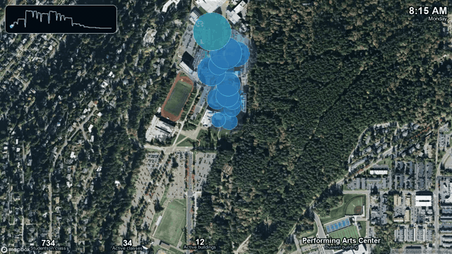
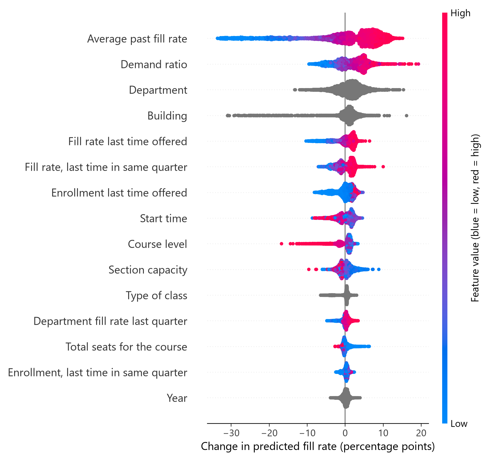
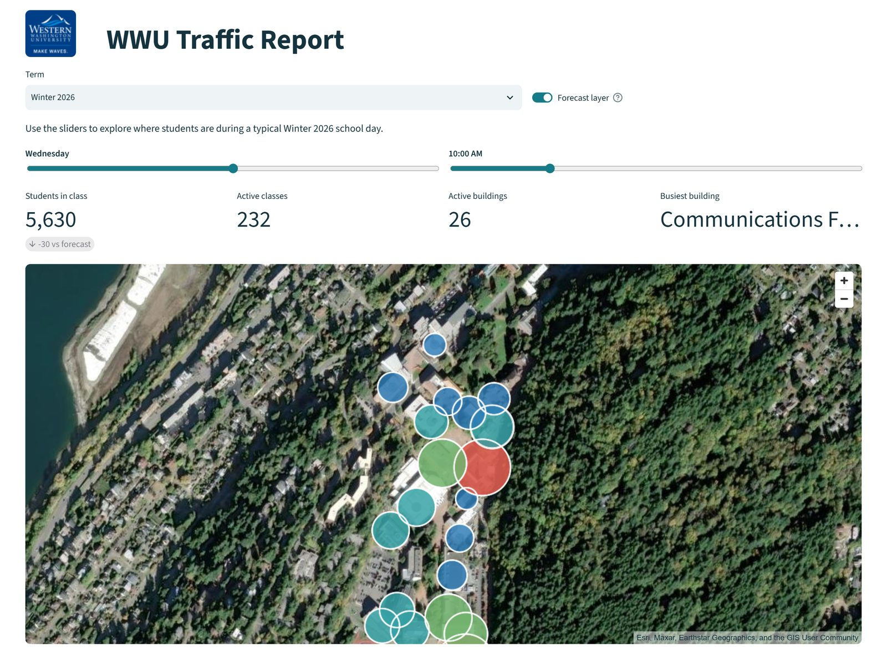

# WWU Traffic Report

A Streamlit map of how many students are in class in each building on Western Washington University's main campus. Pick a term from Fall 2016 to Winter 2027, then drag the weekday and time sliders. A forecast layer adds an XGBoost model's predictions for every term since 2019, each made by a model trained only on earlier terms. Registration for Winter 2027 hasn't opened yet, so that term shows the forecast alone.

## Demo

[](https://www.youtube.com/watch?v=Kktm-zQIgNw)

- [Watch the video walkthrough](https://www.youtube.com/watch?v=Kktm-zQIgNw)
- [Open the live Streamlit app](https://wwu-daily-traffic.streamlit.app/)

## Run locally

The satellite basemap is Esri World Imagery, so you don't need an API key.

```bash
pip install -r requirements.txt
streamlit run streamlit_app.py
```

## Data pipeline

Sections, meeting times, rooms, and enrollment come from WWU's Banner "Browse Classes" page (`registration.banner.wwu.edu`), one row per meeting. Building names and coordinates come from the campus map's ArcGIS layer (`Building_Info__5k`, behind [map.wwu.edu](https://map.wwu.edu)), joined on building code. [`scripts/scrape_schedule.py`](scripts/scrape_schedule.py) scrapes one term into `data/final_data.csv`, and [`scripts/fetch_history.py`](scripts/fetch_history.py) and [`scripts/build_map_data.py`](scripts/build_map_data.py) reuse it to build every term on the map.

Only in-person weekday meetings on the main campus with a room and a set time make it onto the map. Online and TBA classes, weekend-only meetings, off-campus cohorts, and the Lakewood and Shannon Point buildings are dropped.

```bash
python scripts/scrape_schedule.py --list-terms
python scripts/scrape_schedule.py --term 202620
```

## Enrollment forecasting (XGBoost)

WWU posts each term's schedule weeks before registration opens. By then every class has a room and a time, but zero students, which leaves the map empty for upcoming terms. I built an XGBoost model that predicts each section's enrollment from the published schedule, so the map can show a term before anyone registers.

### How it works

The data is 32 terms of public class schedules, Fall 2016 to Winter 2027. After dropping individually arranged courses like independent studies, that's 67,413 sections. The model predicts each section's fill rate (enrolled / capacity, capped at 150%), and multiplying by capacity turns that into a student count for the map.

All 33 features are known when the schedule comes out: department, course level, capacity, building, start time, days per week, how many sections of the course are offered, and the course's history (how full it was last time, last time in the same quarter, and on average). History only looks at earlier terms. I left instructor names out so the model can't rank faculty.

I only ever score the model on a year it hasn't seen. For 2026, I tuned the settings on 2025 (a 12-combination grid with early stopping), retrained on everything through Fall 2025, and ran it once on the 2026 terms (6,082 sections). The baseline is a rule a scheduler could apply by hand: a course fills the same share of its seats as the last time it ran in the same quarter.

### Results on the 2026 terms

| Method | Avg. error (fill-rate points) | Avg. error (students) | R² |
| --- | ---: | ---: | ---: |
| Same average for every section | 26.8 | 7.1 | −0.03 |
| Baseline rule | 16.6 | 4.1 | 0.40 |
| **XGBoost** | **14.5** | **3.6** | **0.59** |

The average 2026 section had 28 seats and 21 students. The model misses by 3.6 students per section against 4.1 for the baseline, a 12.9% smaller error. The gap is wider on brand-new courses, where there's no history to copy: 4.5 students against 5.6 across 181 sections.

One good year could be luck, so I repeated the whole procedure for every year from 2019 to 2026. The model beat the baseline in all eight, by 3.7% to 13.1% (10.8% on average). The closest year was 2020. Almost every class was online in Fall 2020 and the training data had nothing like it, so the model lost that quarter (18.3 vs 15.9 points), though it still won Winter and Spring.

Section errors partly cancel out once the map adds them up. In a typical in-person term the forecast misplaces 16.0% of students at the section level, 7.0% at the building level, and 2.3% for the whole campus (3.1% for the baseline).

Each section also gets an 80% range from a second, quantile XGBoost model. Its raw ranges only covered 72.5% of 2026 outcomes, so I widened them with conformal calibration on a held-out term. Now they cover 79.4%.

### What the model learned



Each dot is a 2026 test section. Its position shows how much that feature moved the prediction, and its color is the feature's value (red high, blue low, gray for categories). A course's own history matters most. Average past fill rate moves a typical prediction by 7.7 points and the demand ratio (past same-quarter enrollment over this term's seats) moves it by 3.5, with high values of either pushing it up. Department and building come next. Upper-division courses and bigger sections fill a smaller share of their seats, and later start times lean the same way.

### In the app



For every term since 2019, the forecast layer draws the predictions as white rings over filled circles of actual enrollment (above: Winter 2026, Wednesday at 10:00 AM). Winter 2027 shows the forecast alone: 41,336 enrollments against 42,058 last Winter, busiest on Wednesday at 10:00 AM with about 5,520 students in class.

### Limitations

Banner keeps each section's final capacity, and caps raised during registration give the past-term scores a small hint about demand. Retraining without the capacity features only moves the 2026 error from 14.5 to 14.8 points. Winter 2027 uses pre-registration capacities, so it will come in low if departments add seats. The map counts enrolled students, so it can't tell who actually shows up.

### Reproduce

```bash
pip install -r requirements-ml.txt
python scripts/fetch_history.py      # ~10 min, cached in data/raw/
python scripts/build_features.py
python scripts/train_model.py        # walk-forward backtest, 2026 results, intervals (~15 min)
python scripts/explain_model.py      # SHAP values and calibration
python scripts/forecast.py           # Winter 2027 forecast
python scripts/build_map_data.py     # data/map_terms.parquet for the app
```
